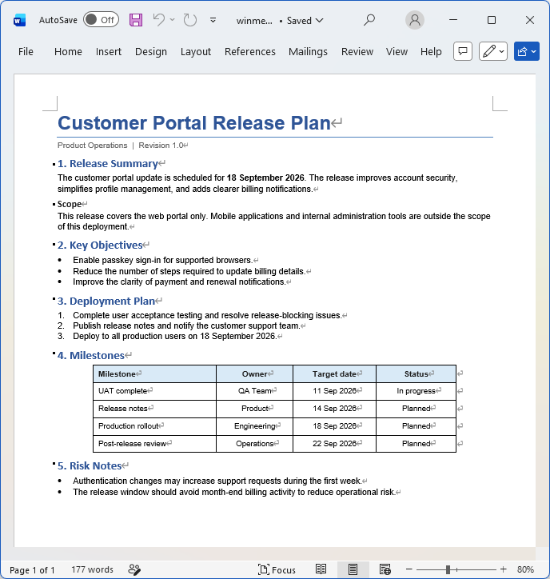
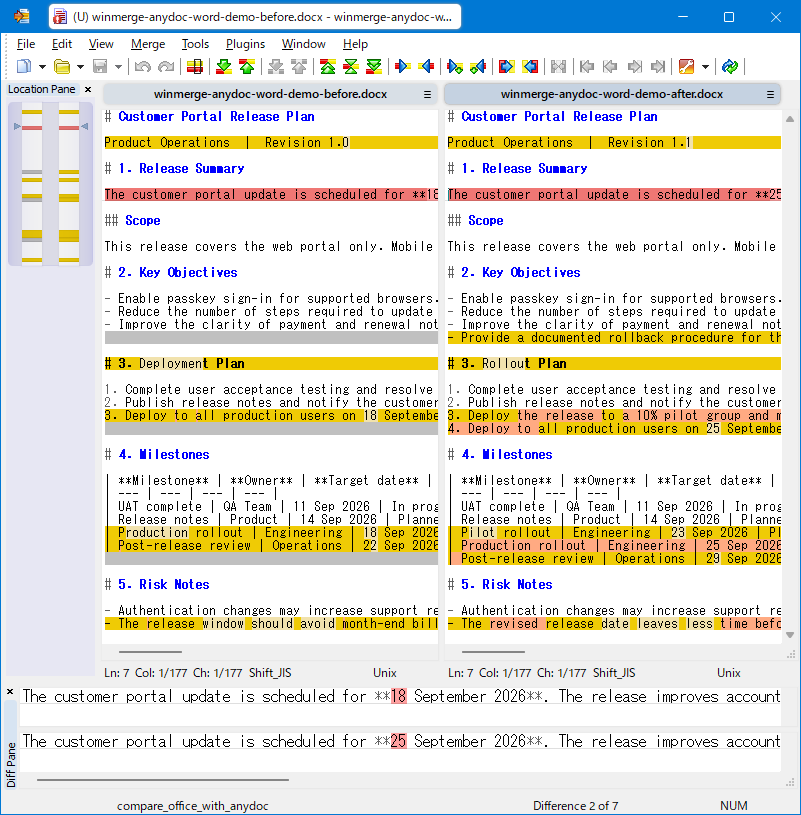

# winmerge-anydoc

[English](README.md) | 日本語

**Word、Excel、PowerPointファイルをWinMergeで比較できます。Microsoft OfficeもPythonも不要です。**

`winmerge-anydoc` は、Office文書をWinMergeで比較するための展開プラグインです。

文書を単純なプレーンテキストとして取り出すのではなく、表・見出し・リストなどの構造をできるだけ保ったMarkdown形式へ変換してからWinMergeで比較します。

**インストールはDLLを1つ `MergePlugins` フォルダーへコピーするだけです。**

## 比較例

**Wordでの表示**



*見出し、箇条書き、番号付きリスト、表を含むWord（`.docx`）文書の例。*

**WinMergeでの比較**



*winmerge-anydocで2つのWord（`.docx`）ファイルを比較した例。文書の構造がMarkdownとして比較画面に残っています。*

## 特長

### DLL 1つだけで使用可能

文書変換に必要な機能は `compare_office_with_anydoc.dll` に組み込まれています。

以下のものを別途用意する必要はありません。

* Microsoft Office
* Python環境
* Pythonパッケージ
* 補助実行ファイル
* 外部の文書変換プログラム
* Visual C++ Redistributable

DLLを配置してWinMergeを再起動すれば使用できます。

### 表や見出しなどの構造を保って比較

Office文書の内容を単純なプレーンテキストとして抽出するのではなく、Markdown形式へ変換して比較します。

文書の内容や形式に応じて、次のような構造を比較画面に残すことができます。

* 見出し
* リスト
* 表

特にExcelの表や、文書構造そのものに変更がある場合に、単純なテキスト抽出より差分を把握しやすくなります。

内部では **GitHub-Flavored Markdown** へ変換しています。

### Microsoft Office不要

Word、Excel、PowerPointをインストールしていないPCでも使用できます。

OfficeアプリケーションをCOM経由で起動・操作して変換する方式ではなく、文書ファイルを直接解析します。

### 外部の変換プログラムを起動しない

文書変換にはRust製ライブラリ [anydoc](https://github.com/firecrawl/anydoc) を使用しています。

`anydoc` をライブラリとしてDLLに直接組み込んでいるため、変換時に別のコンバーターや補助プログラムを起動しません。

文書変換はWinMergeのプラグイン内部で実行されます。

### 高速なローカル変換

`anydoc` は、文書をMarkdownへ高速に変換するPure Rustのライブラリです。

anydoc公式のベンチマークでは、ベンチマーク対象文書の変換時間の中央値が5ミリ秒未満と報告されています。

これは `anydoc` 単体の変換時間であり、WinMergeでの比較処理全体の性能を示すものではありません。

詳細は [anydoc benchmark](https://github.com/firecrawl/anydoc#benchmark) を参照してください。

## 対応ファイル形式

| 種類         | 拡張子                                                        |
| ---------- | ---------------------------------------------------------- |
| Word       | `.doc`, `.docx`, `.docm`                                   |
| Excel      | `.xls`, `.xlsx`, `.xlsm`, `.xlsb`                          |
| PowerPoint | `.ppt`, `.pps`, `.pot`, `.pptx`, `.pptm`, `.ppsx`, `.ppsm` |

`.doc`、`.xls`、`.ppt` などOffice 97-2003で一般的な形式と、`.docx`、`.xlsx`、`.pptx` などの新しい形式の両方に対応しています。

## 動作環境

* Windows 10 または Windows 11 x64
* 64ビット版 [WinMerge](https://winmerge.org/)

Microsoft Office、Python、外部の文書変換プログラムは必要ありません。

## インストールと使い方

1. [GitHub Releases](https://github.com/namulab/winmerge-anydoc/releases) から最新のZIPパッケージをダウンロードします。
2. ZIPファイルを展開します。
3. `compare_office_with_anydoc.dll` をWinMergeの `MergePlugins` フォルダーへコピーします。
4. WinMergeを再起動します。
5. WinMergeのメニューから **［プラグイン］→［自動展開］** を有効にします。
6. 対応するOffice文書を通常どおり比較します。

［自動展開］がすでに有効になっている場合は、設定を変更する必要はありません。

自動展開を有効にすると、WinMergeがファイルの拡張子に対応する展開プラグインを自動的に選択します。

同じ拡張子に対応する展開プラグインが複数インストールされている場合などは、`winmerge-anydoc` を展開プラグインとして手動で選択することもできます。

## 他の方式との違い

Office文書をWinMergeで比較する方法には、いくつかの方式があります。

| 方式                       | 一般的な特徴                                   | winmerge-anydoc                     |
| ------------------------ | ---------------------------------------- | ----------------------------------- |
| xdocdiff / xdoc2txt系     | 文書内容をテキストとして抽出して比較                       | Markdownへ変換し、表や見出しなどの構造を可能な範囲で残して比較 |
| MarkItDownなどPythonベースの変換 | Python環境や形式ごとのパッケージが必要                   | Python不要。DLLだけで動作                   |
| Office自動操作               | インストール済みのMicrosoft Officeを使用して文書を開く・変換する | Office不要。文書ファイルを直接解析                |
| 外部コンバーター方式               | 別の変換プログラムを起動してからWinMergeへ結果を渡す           | 変換ライブラリをDLLに組み込み、プラグイン内部で変換         |

この比較は主に、**導入方法と文書変換の方式**についての違いを示しています。

各ツールには対応形式や得意な用途の違いがあり、`winmerge-anydoc` はWinMergeでOffice文書を手軽に比較することに重点を置いています。

## 仕組み

```text
Office文書
    |
    v
compare_office_with_anydoc.dll
    |
    |  anydoc（Rustライブラリとして組み込み）
    v
GitHub-Flavored Markdown
    |
    v
WinMergeによるテキスト比較
```

`anydoc` は外部プログラムとして実行するのではなく、RustライブラリとしてプラグインDLLに直接組み込まれています。

そのため、

```text
WinMerge
  -> 外部プログラムを起動
  -> 文書を変換
  -> 結果をWinMergeへ戻す
```

という処理ではなく、WinMergeのプラグイン内部で文書からMarkdownへの変換を行います。

変換は比較のための一方向変換です。

比較画面上で変換後のMarkdownを変更しても、元のOffice文書へ書き戻されることはありません。

## ソースからのビルド

### 必要な環境

* Rust 1.97.1
* MSVC C++ビルドツールを含むVisual Studio
* MIDLおよびResource Compilerを含むWindows SDK

必要なRustツールチェーンとターゲットは `rust-toolchain.toml` で定義されています。

リリース版をビルドします。

```powershell
cargo build --release
```

生成されるプラグインDLLは次の場所にあります。

```text
target\release\compare_office_with_anydoc.dll
```

リリースビルドでは、プラグインが使用するMSVC Cランタイムを静的リンクしています。

## テスト

COMプラグインのスモークテストを実行します。

```console
cargo test --test com_plugin
```

Rustの統合テストは実際のプラグインDLLをビルドして読み込みます。テストではリポジトリ内のテスト用Office文書を使用し、一時的な変換結果はシステムの一時ディレクトリにのみ出力します。

## 謝辞

文書変換には [anydoc](https://github.com/firecrawl/anydoc) を使用しています。

anydocは、Office文書などをGitHub-Flavored Markdownへ変換するRustライブラリです。

## ライセンス

このプロジェクトはMIT Licenseで公開しています。詳細は [LICENSE](LICENSE) を参照してください。

サードパーティソフトウェアのライセンスおよび著作権表示は [THIRD_PARTY_NOTICES.md](THIRD_PARTY_NOTICES.md) に記載しています。

## anydoc の自動更新

GitHub Actions が毎日 crates.io の anydoc の正式版を確認します。更新がある場合は
ビルド・テスト後に本プロジェクトのパッチバージョンを上げ（例: `0.1.1 → 0.1.2`）、
GitHub Release を公開します。有効化の条件や失敗時の再実行方法は
[自動リリースの運用ガイド](docs/auto-release.md)を参照してください。

Copyright (c) 2026 namulab
